# Hill climb progress: Qwen3.6-35B-A3B decode tps

This is the live record of the hill climb. Every measured run appends a row and moves the
chart's points. The mission (auto-research.md / RESEARCH-Q4-KV.md): land the int4 KV cache,
record the 262k baseline (empty / 32k / 128k prompts, 512-token greedy decode, server context
262144), then climb until every cell is at 2.00x its own baseline.

Status legend: **baseline** (the first valid measurement of a cell) / **trial** (one change
over the champion) / **champion** (the promoted best) / **rejected** (no win or a regression).

## The cells and the target

| Cell | prompt | output | The number to double |
| --- | ---: | ---: | ---: |
| empty | 1 | 512 | decode tok/s |
| ctx32k | 32,768 | 512 | decode tok/s |
| ctx128k | 131,072 | 512 | decode tok/s |

Server context 262144 throughout (the int4 KV cache is 1.40 GiB there), model
`Qwen3.6-35B-A3B-uncensored-heretic-Native-MTP-Preserved-Q5_K_S.gguf`, RTX 3070 8 GB.

## Measurements (append only)

| # | date (UTC) | commit | change / config | cell | decode tok/s | prefill tok/s | TTFT ms | peak GiB | status |
| - | --- | --- | --- | --- | ---: | ---: | ---: | ---: | --- |
| 0 | 2026-11-15 | a64a20b (lane) | int4 KV landed + verified (KVNOTE.md); serving at 32k ctx, MTP 2 + greedy sampler | empty@32k-ctx | 34.0 | - | - | 6.92 | prior-session reference, not a 262k baseline |
| 0 | 2026-11-15 | a64a20b (lane) | same | 15.5k@32k-ctx | 22.4 | 147.9 | - | 6.93 | prior-session reference, not a 262k baseline |
| 1 | 2026-11-17 00:44Z | b81319b | **262k baseline, empty cell**: MAX_CONTEXT=262144 PREFILL=1024 MTP=2 CPU_THREADS=8 KV=int4 SAMPLING greedy (drafting engaged, 308/410 accepted); 0 expert slots | empty | **21.92** | 3.8 (measured, primed; cold warmup TTFT 972 ms) | 261 (primed) / 972 (cold) | 7.35 | baseline (first valid run; repeats pending) |
| 1 | 2026-11-17 00:53Z | b81319b | **262k baseline, ctx32k cell** (31,130 actual prompt tokens): same config, drafts 306/410 | ctx32k | **18.94** | 289.2 (measured, primed; cold warmup 236.0 from TTFT 131.9 s) | 107,624 (primed) / 131,912 (cold) | 7.38 | baseline (first valid run; repeats pending) |
| 1 | 2026-11-17 01:11Z | b81319b | **262k baseline, ctx128k cell** (124,530 actual prompt tokens): same config, drafts 295/432 | ctx128k | **11.80** | 219.9 (measured, primed; cold warmup 213.4 from TTFT 583.5 s) | 566,272 (primed) / 583,533 (cold) | 7.38 | baseline (first valid run; repeats pending) |

**The initial tps (pass 1)**: empty 21.92, ctx32k 18.94, ctx128k 11.80 decode tok/s.
**The 2.00x targets**: empty 43.85, ctx32k 37.87, ctx128k 23.60.

## Chart: decode tok/s per cell across trials

```mermaid
xychart-beta
    title "Decode tok/s (262k server context, 512-token greedy)"
    x-axis [baseline]
    y-axis "tok/s" 0 --> 140
    bar [0, 0, 0]
    bar [0, 0, 0]
```

*(The two bars are empty and ctx32k+ctx128k grouped readings; points are added as the
baseline lands and trials are measured. Until the 262k baseline exists, the chart shows
zeros — no number is promoted by assumption.)*

## Champion ledger

| date | incumbent | challenger | frozen source | decision |
| --- | --- | --- | --- | --- |
| - | (none yet) | - | - | the 262k baseline is the first incumbent once measured |

## Where the climb starts (evidence so far)

- int4 KV cache: landed and verified (`docs/KVNOTE.md`): VERIFY=1 0/6103 mismatches all
  dtypes; pinned-placement fp32 gate 10/10 bit-identical to the old binary; int4 answers
  correct at 32k/64k/128k needle prompts; 262114 starts at 6.928 GiB peak.
- The routed experts (21.14 GiB, pageable host memory) are the known ceiling at short
  contexts; at 262k the engine chose **0 expert slots** — expert placement is the first
  hypothesis to re-measure (B1).
- MTP drafting engages only with the greedy-sampler config (`SAMPLING='{"presence_penalty":0}'`);
  MTP 2 beat MTP 4 at 32k (34.0 vs 32.0 empty).

## Not yet measured (open)

- The 262k baseline table itself (empty / ctx32k / ctx128k) — next step.
- Drafting acceptance at 262k; expert-slot ceilings at 262k; the attention wall at 128k/262k.
