# Hill climb progress: Qwen3.6-35B-A3B decode tps

This is the live record of the hill climb. Every measured run appends a row and moves the
chart's points. The mission (auto-research.md / RESEARCH-Q4-KV.md): land the int4 KV cache,
record the 262k baseline (empty / 32k / 128k prompts, 512-token greedy decode, server context
262144), then climb until every cell is at 2.00x its own baseline.

Status legend: **baseline** (the first valid measurement of a cell) / **trial** (one change
over the champion) / **champion** (the promoted best) / **rejected** (no win or a regression).

## The cells and the target

| Cell | prompt | output | The number to double |
| --- | ---: | ---: | ---: |
| empty | 1 | 512 | decode tok/s |
| ctx32k | 32,768 | 512 | decode tok/s |
| ctx128k | 131,072 | 512 | decode tok/s |

Server context 262144 throughout (the int4 KV cache is 1.40 GiB there), model
`Qwen3.6-35B-A3B-uncensored-heretic-Native-MTP-Preserved-Q5_K_S.gguf`, RTX 3070 8 GB.

## Measurements (append only)

| # | date (UTC) | commit | change / config | cell | decode tok/s | prefill tok/s | TTFT ms | peak GiB | status |
| - | --- | --- | --- | --- | ---: | ---: | ---: | ---: | --- |
| 0 | 2026-11-15 | a64a20b (lane) | int4 KV landed + verified (KVNOTE.md); serving at 32k ctx, MTP 2 + greedy sampler | empty@32k-ctx | 34.0 | - | - | 6.92 | prior-session reference, not a 262k baseline |
| 0 | 2026-11-15 | a64a20b (lane) | same | 15.5k@32k-ctx | 22.4 | 147.9 | - | 6.93 | prior-session reference, not a 262k baseline |
| 1 | 2026-11-17 00:44Z | b81319b | **262k baseline, empty cell**: MAX_CONTEXT=262144 PREFILL=1024 MTP=2 CPU_THREADS=8 KV=int4 SAMPLING greedy (drafting engaged, 308/410 accepted); 0 expert slots | empty | **21.92** | 3.8 (measured, primed; cold warmup TTFT 972 ms) | 261 (primed) / 972 (cold) | 7.35 | baseline (first valid run; repeats pending) |
| 1 | 2026-11-17 00:53Z | b81319b | **262k baseline, ctx32k cell** (31,130 actual prompt tokens): same config, drafts 306/410 | ctx32k | **18.94** | 289.2 (measured, primed; cold warmup 236.0 from TTFT 131.9 s) | 107,624 (primed) / 131,912 (cold) | 7.38 | baseline (first valid run; repeats pending) |
| 1 | 2026-11-17 01:11Z | b81319b | **262k baseline, ctx128k cell** (124,530 actual prompt tokens): same config, drafts 295/432 | ctx128k | **11.80** | 219.9 (measured, primed; cold warmup 213.4 from TTFT 583.5 s) | 566,272 (primed) / 583,533 (cold) | 7.38 | baseline (first valid run; repeats pending) |
| 1r | 2026-11-17 01:20Z | b81319b | pass-2 repeat (background job; **killed at checkpoint** mid-ctx128k — empty+ctx32k rounds completed, numbers recovered from the engine log) | empty | 21.86 | - | - | 7.35 | repeat (0.3% spread vs pass 1 — within tolerance, no pass 3 needed) |
| 1r | 2026-11-17 01:24Z | b81319b | pass-2 repeat, engine-log reconstruction (warmup-int 19.6 + measured-int 20.4) | ctx32k | 20.4 | 275.6 | - | 7.35 | repeat (7.7% spread vs pass 1 → pass 3 required) |
| 1r | 2026-11-17 01:52Z | b81319b | pass-3 repeat (bench_runner.sh detached; internal warmup 19.6 + measured 19.52) | ctx32k | **19.52** | 259.0 | 120,189 | 7.38 | repeat (median of 18.94 / 20.4 / 19.52 = **19.52**) |

**The initial tps (pass 1)**: empty 21.92, ctx32k 18.94, ctx128k 11.80 decode tok/s.
**Repeats so far**: empty 21.86 (0.3%), ctx32k 20.4 → 19.52 (median 19.52), ctx128k pass-2 running.
**The 2.00x targets**: empty 43.85, ctx32k 37.87 (vs median 19.52), ctx128k 23.60.

## Chart: decode tok/s per cell across trials

```mermaid
xychart-beta
    title "Decode tok/s (262k server context, 512-token greedy)"
    x-axis [baseline, medians]
    y-axis "tok/s" 0 --> 140
    bar [21.92, 21.89]
    bar [18.94, 19.52]
    bar [11.8, 11.8]
```

*(Bars: empty, ctx32k, ctx128k. First cluster = pass-1, second = current medians.
The 2x targets (43.85 / 37.87 / 23.60) sit 2x above each bar's first cluster.)*

## Champion ledger

| date | incumbent | challenger | frozen source | decision |
| --- | --- | --- | --- | --- |
| 2026-11-17 | 262k int4 baseline (empty 21.92 / 32k 19.52 / 128k 11.8) | (none yet) | b81319b | incumbent set; trials next |

## Where the climb starts (evidence so far)

- int4 KV cache: landed and verified (`docs/KVNOTE.md`): VERIFY=1 0/6103 mismatches all
  dtypes; pinned-placement fp32 gate 10/10 bit-identical to the old binary; int4 answers
  correct at 32k/64k/128k needle prompts; 262114 starts at 6.928 GiB peak.
- MTP drafting engages only with the greedy-sampler config (`SAMPLING='{"presence_penalty":0}'`);
  acceptance at 262k: 308/410 (75%) on empty → a = 2.51 tokens per verify step.
- Ceiling math (`research/hillclimb/THEORY.md`): the CPU expert pool reads ~0.630 GiB per
  verify step at an effective ~6 GB/s (empty: ~102 of 114.6 ms/step is pool time). 2x targets
  are feasible with the pool at ~12+ GB/s effective and the int4 attention kernel fixed
  (~0.738 GB/step at byte-granular loads today).
- Expert slots at 262k: **0/layer** (free 1.28 GiB − MMQ staging 1.03 − reserve 0.77 < 0).

## Not yet measured (open)

- ctx128k pass-2/pass-3 repeats (running, ~40 min).
- Device-copy VRAM bandwidth + RAM stream bandwidth (measure between passes, GPU serialized).
- Trials: NO_MMQ slots, CT 5, MTP 3, arena hugepages/prefetch (code), int4 attention 128-bit loads.
- nsys/ncu profiling per §9.0 once the baseline repeats finish.
