# Hill climb progress: Qwen3.6-35B-A3B decode tps

This is the live record of the hill climb. Every measured run appends a row and moves the
chart's points. The mission (auto-research.md / RESEARCH-Q4-KV.md): land the int4 KV cache,
record the 262k baseline (empty / 32k / 128k prompts, 512-token greedy decode, server context
262144), then climb until every cell is at 2.00x its own baseline.

Status legend: **baseline** (the first valid measurement of a cell) / **trial** (one change
over the champion) / **champion** (the promoted best) / **rejected** (no win or a regression).

## The cells and the target

| Cell | prompt | output | The number to double |
| --- | ---: | ---: | ---: |
| empty | 1 | 512 | decode tok/s |
| ctx32k | 32,768 | 512 | decode tok/s |
| ctx128k | 131,072 | 512 | decode tok/s |

Server context 262144 throughout (the int4 KV cache is 1.40 GiB there), model
`Qwen3.6-35B-A3B-uncensored-heretic-Native-MTP-Preserved-Q5_K_S.gguf`, RTX 3070 8 GB.

## Measurements (append only)

| # | date (UTC) | commit | change / config | cell | decode tok/s | prefill tok/s | TTFT ms | peak GiB | status |
| - | --- | --- | --- | --- | ---: | ---: | ---: | ---: | --- |
| 0 | 2026-11-15 | a64a20b (lane) | int4 KV landed + verified (KVNOTE.md); serving at 32k ctx, MTP 2 + greedy sampler | empty@32k-ctx | 34.0 | - | - | 6.92 | prior-session reference, not a 262k baseline |
| 0 | 2026-11-15 | a64a20b (lane) | same | 15.5k@32k-ctx | 22.4 | 147.9 | - | 6.93 | prior-session reference, not a 262k baseline |
| 1 | 2026-11-17 00:44Z | b81319b | **262k baseline, empty cell**: MAX_CONTEXT=262144 PREFILL=1024 MTP=2 CPU_THREADS=8 KV=int4 SAMPLING greedy (drafting engaged, 308/410 accepted); 0 expert slots | empty | **21.92** | 3.8 (measured, primed; cold warmup TTFT 972 ms) | 261 (primed) / 972 (cold) | 7.35 | baseline (first valid run; repeats pending) |
| 1 | 2026-11-17 00:53Z | b81319b | **262k baseline, ctx32k cell** (31,130 actual prompt tokens): same config, drafts 306/410 | ctx32k | **18.94** | 289.2 (measured, primed; cold warmup 236.0 from TTFT 131.9 s) | 107,624 (primed) / 131,912 (cold) | 7.38 | baseline (first valid run; repeats pending) |
| 1 | 2026-11-17 01:11Z | b81319b | **262k baseline, ctx128k cell** (124,530 actual prompt tokens): same config, drafts 295/432 | ctx128k | **11.80** | 219.9 (measured, primed; cold warmup 213.4 from TTFT 583.5 s) | 566,272 (primed) / 583,533 (cold) | 7.38 | baseline (first valid run; repeats pending) |
| 1r | 2026-11-17 01:20Z | b81319b | pass-2 repeat (background job; **killed at checkpoint** mid-ctx128k — empty+ctx32k rounds completed, numbers recovered from the engine log) | empty | 21.86 | - | - | 7.35 | repeat (0.3% spread vs pass 1 — within tolerance, no pass 3 needed) |
| 1r | 2026-11-17 01:24Z | b81319b | pass-2 repeat, engine-log reconstruction (warmup-int 19.6 + measured-int 20.4) | ctx32k | 20.4 | 275.6 | - | 7.35 | repeat (7.7% spread vs pass 1 → pass 3 required) |
| 1r | 2026-11-17 01:52Z | b81319b | pass-3 repeat (bench_runner.sh detached; internal warmup 19.6 + measured 19.52) | ctx32k | **19.52** | 259.0 | 120,189 | 7.38 | repeat (median of 18.94 / 20.4 / 19.52 = **19.52**) |
| 1r | 2026-11-17 02:25Z | b81319b | pass-2 repeat via lean_bench128k.sh (1 invocation, detached; prefill 563 s at 215.5 tok/s, decode 44.5 s) | ctx128k | **11.66** | 215.5 | 577,836 | 7.38 | repeat (1.19% spread vs pass 1 ≤ 2% → pass-3 skipped per protocol) |
| 2 | 2026-11-17 ~04:29Z | - | **uint4 candidate** (the Q4_K→int4 V-path read, S10.2): one clean ctx128k cell (the empty/ctx32k cells stayed no-verdict: the 3-s watchdog poll confound) | ctx128k | 17.77 | - | - | - | trial → verdict **keep** (the same-day pair: measured decode 28.81 s vs the champion's 43.91 s; +52% vs the anchor 11.73) |
| 3 | 2026-11-17 09:27Z | bb58a51 | **promotion compose-clean, empty cell**: the compose binary (md5 8833c30b, q5k+uint4, STRATA_KQ256=1), serve → wait health → settle 900 s → bench, NO watchdog | empty | **22.53** | 4.16 | 240.5 | 7.32 | champion (PROMOTE) |
| 3 | 2026-11-17 09:36Z | bb58a51 | promotion compose-clean, ctx32k cell (31,130 actual prompt tokens) | ctx32k | **21.76** | 275.1 | 113,148 | 7.35 | champion (PROMOTE) |
| 3 | 2026-11-17 09:58Z | bb58a51 | promotion compose-clean, ctx128k cell (124,520 actual prompt tokens) | ctx128k | **17.52** | 219.7 | 566,899 | 7.35 | champion (PROMOTE) |
| 3c | 2026-11-17 10:21Z | 74c5f1f4 (the base binary) | **base-clean control, empty cell** (the window-conflict demand: the same promotion protocol, the load reused, the settle symmetric) | empty | 21.57 | 2.65 | 377.5 | 7.32 | control (within ±2% of the anchors — the anchors held) |
| 3c | 2026-11-17 10:29Z | 74c5f1f4 | base-clean control, ctx32k cell | ctx32k | 19.77 | 262.2 | 118,723 | 7.33 | control |
| 3c | 2026-11-17 10:52Z | 74c5f1f4 | base-clean control, ctx128k cell | ctx128k | 11.97 | 216.3 | 575,728 | 7.35 | control |
| 4 | 2026-11-17 12:07Z | bb58a51 | **S12-C worker screen, w=5** (CPU_THREADS=5, the compose binary, the promotion protocol per config: stop → serve → health → settle 900 s → bench) | empty | 22.91 | 2.14 | 467.9 | 7.31 | screen: +1.7% vs the reused w=8 anchor — below the +3% bar, no confirm pass |
| 4 | 2026-11-17 12:30Z | bb58a51 | S12-C worker screen, w=6 (the engine warns: 6 workers + its own main thread = 7 threads on 6 cores) | empty | 20.90 | 0.94 | 1065.0 | 7.33 | screen: −7.2% — rejected |
| 4 | 2026-11-17 12:55Z | bb58a51 | S12-C worker screen, w=12 (the engine warns: oversubscription, the extra workers spin) | empty | 12.07 | 0.69 | 1452.6 | 7.32 | screen: −46.4% — rejected |
| 4t | 2026-11-17 02:38Z | 74c5f1f4 (the base binary) | **trial A nommq**: STRATA_Q36_NO_MMQ=1 (frees the ~1.03 GiB MMQ staging pair so the slot guard can place experts in VRAM; the prompt path drops to the native quantized kernels; the ctx128k cell skipped — the native prefill ~65 min > the 30-min budget). Deltas vs the pass medians 21.89 / 19.52 / 11.73 | empty | 23.00 | 2.93 | - | 6.88 | trial (+5.0%) — recovered from research/trials/ |
| 4t | 2026-11-17 02:38Z | 74c5f1f4 | trial A nommq | ctx32k | 18.64 | 96.8 | - | 6.90 | rejected: −4.5% and the prefill collapsed to 96.8 tok/s (MMQ ~250); no ctx128k cell — two cells measured, one a regression |
| 4t | 2026-11-17 03:00Z | 74c5f1f4 | **trial B' ct5**: CPU_THREADS=5 (the engine's recommendation on this 6-core CPU) | empty | 21.69 | 3.56 | - | 7.36 | trial (−0.9%) — recovered |
| 4t | 2026-11-17 03:00Z | 74c5f1f4 | trial B' ct5 | ctx32k | 19.33 | 262.3 | - | 7.37 | trial (−0.9%) |
| 4t | 2026-11-17 03:00Z | 74c5f1f4 | trial B' ct5 | ctx128k | 11.71 | 210.3 | - | 7.37 | no win (a wash): all three cells within ±2% |
| 4t | 2026-11-17 03:46Z | 74c5f1f4 | **trial C mtp3**: MTP=3 | empty | 20.81 | 2.10 | - | 7.34 | trial (−4.9%) — recovered |
| 4t | 2026-11-17 03:46Z | 74c5f1f4 | trial C mtp3 | ctx32k | 18.55 | 258.7 | - | 7.37 | trial (−5.0%) |
| 4t | 2026-11-17 03:46Z | 74c5f1f4 | trial C mtp3 | ctx128k | 10.92 | 213.2 | - | 7.37 | rejected: −6.9% — MTP stays 2 |
| 4t | 2026-11-17 04:27Z | 74c5f1f4 | **trial D mmqslots2**: EXPERT_SLOTS=2 (MMQ kept; mission lever B1 at the VRAM edge) | empty | 20.11 | 2.70 | - | 7.54 | trial (−8.1%) — recovered |
| 4t | 2026-11-17 04:27Z | 74c5f1f4 | trial D mmqslots2 | ctx32k | 18.46 | 249.8 | - | 7.57 | trial (−5.4%) |
| 4t | 2026-11-17 04:27Z | 74c5f1f4 | trial D mmqslots2 | ctx128k | 11.69 | 184.5 | - | 7.57 | rejected: −0.3% there but the empty/32k cells regress; peak up to 7.57 GiB |
| 5 | 2026-11-17 14:42Z | df3c3230 (the POOLMS binary, gate 10/10 bit-identical) | **Lever A's capture** (STRATA_POOLMS=1, the FULL champion config — compose, STRATA_KQ256=1, w=8, 262k, MTP on "drafts accepted 308 of 410", settle 900 s, no watchdog): empty 19.07 = **−15.3% vs the compose-clean anchor 22.53 → the box state drifted; per the pre-registered rule the share reading is QUALIFIED, not voided**. The pool-ms slice (17,403 lines): the measured round = 8,640 calls = **41 calls/step (one call per layer; ~204 steps at 2.51 tokens/step — the call-model check answered)**, the pool = **60.6% of the measured step** (16,280 ms of 26,854; stall-free 55.8% — only 81 calls >10 ms sum 8%), the volume **1.52 GB/step** (inside the 660 MB–1.98 GB bracket; ~18.4 distinct experts/layer → the MTP rows lean shared), the aggregate rate **19.0 GB/s (stall-free 20.3)** vs the 28 GB/s warmed ceiling → per the pre-registered thresholds (~14–20) **the pattern cost matches → S13-(a) proceeds**. Phase split: gu 65.1% + down 34.1% = 99.2% (q 0.2%) → the weight streaming dominates. The warmup round: **78% of its pool SUM in >10 ms calls (max 454 ms/call)** vs the measured round's 8% → the idle-residency stall lives IN the pool (a NEW lever: arena residency through idle) | empty | 19.07 | 1.04 | 959.3 | 7.31 | measurement (the pool-share reading, qualified −15.3% drift) | pool 60.6% of the step at 19–20.3 GB/s of a 28 ceiling; S14's reopening condition (pool ≥ ~60% of the step AND S3 blocked) is **MET** |
| 6 | 2026-11-17 16:01Z | 8833c30b (the champion compose) | **THE MODEL SWITCHED — the Q4_K_S 262k baseline, empty cell**: the champion config unchanged (MTP 2 greedy CT 8 KV int4 STRATA_KQ256=1, 262k server ctx, settle 900 s, no watchdog); the model file now Qwen3.6-35B-A3B-…-Q4_K_S.gguf (20.43 GB, the expert arena 17.45 GiB vs the Q5_K_S's 21.14). **The model emitted EOS at 404 of the requested 512 tokens** (the smaller quant changed the greedy path; the rate is honest over 404 tokens — the KV delta 404→512 is ~0.1%) | empty | **23.51** | 3.8 | 262 | 6.59 | the Q4_K_S campaign's anchor (vs the compose champion's same-day empty 22.53 = **+4.4%**, qualified: single pass, 6.5 h apart, the drift band −15.3%) |
| 6 | 2026-11-17 16:05Z | 8833c30b | the Q4_K_S baseline, ctx32k cell (31,130 actual prompt tokens — the same actual count as the Q5's cells) | ctx32k | **23.03** | 323.2 | 96,326 | 6.62 | the Q4_K_S anchor (vs the champion's same-day 21.76 = **+5.8%**, qualified) |
| 6 | 2026-11-17 16:23Z | 8833c30b | the Q4_K_S baseline, ctx128k cell (124,520 actual prompt tokens — the same actual count as the Q5's cells) | ctx128k | **18.19** | 251.6 | 494,832 | 6.62 | the Q4_K_S anchor (vs the champion's same-day 17.52 = **+3.8%**, qualified; the pass's done marker bench_complete 16:23Z) |
| 7 | 2026-11-17 16:44Z | 8833c30b | **trial T1 (S15-A) the MTP-off isolation, empty cell**: the champion config MINUS the SAMPLING export (the drafting off, "drafts accepted 0 of 0" live-verified; the q5k kernel's multi-token path also disengages — the confound); **the leg decoded the FULL 512 tokens (protocol-clean, no EOS — the MTP-on leg's EOS@404 is plausibly MTP-caused)** | empty | 19.31 | 4.2 | 235 | 6.59 | trial (**−17.9% vs the MTP-on baseline 23.51**) — the MTP stays ON |
| 7 | 2026-11-17 16:49Z | 8833c30b | trial T1 the MTP-off isolation, ctx32k cell (31,130 actual tokens) | ctx32k | 18.25 | 325.2 | 95,711 | 6.62 | trial (**−20.7%** vs 23.03; the prefill MTP-independent as expected) |
| 7 | 2026-11-17 17:06Z | 8833c30b | trial T1 the MTP-off isolation, ctx128k cell (124,520 actual tokens) | ctx128k | 15.71 | 254.1 | 489,997 | 6.62 | trial (**−13.7%** vs 18.19) — **the verdict: the MTP drafting amortization WINS at 262k (~+14–21%/cell); the clean bench's MTP-off +26% empty came WITH the S=15 slots at 64k and does NOT transfer; the champion config keeps MTP 2 + greedy** |

**The initial tps (pass 1)**: empty 21.92, ctx32k 18.94, ctx128k 11.80 decode tok/s.
**Repeats (final)**: empty 21.86 (0.3%), ctx32k 20.44 → 19.52 (median 19.52), ctx128k 11.66 (1.19%).
**Medians across passes**: empty 21.89, ctx32k 19.52, ctx128k 11.73 — the pass-1 table stays the
recorded baseline the 2.00x targets are anchored to.
**The 2.00x targets**: empty 43.85, ctx32k 37.87 (vs median 19.52), ctx128k 23.60.

**THE CHAMPION (promoted 2026-11-17 ~10:52Z, commit a7c1580 records the decision)**: the
compose binary (md5 8833c30b, q5k + uint4, STRATA_KQ256=1) — empty **22.53**, ctx32k
**21.76**, ctx128k **17.52** decode tok/s (the compose-clean triple). The same-day
same-protocol control (the base-clean leg, the window-conflict demand): empty 21.57,
ctx32k 19.77, ctx128k 11.97 — compose/base deltas **+4.4% / +10.0% / +46.4%**, the median
win +10.0% ≥ the 2% bar, no regressions, the cmp gate 10/10 bit-identical. The base-clean
control read within ±2% of the cross-day anchors (−1.5% / +1.3% / +2.0%) — the anchors held.
**The 2.00x progress**: empty 22.53/43.85 (51%), ctx32k 21.76/37.87 (57%), ctx128k
17.52/23.60 (74%). Future chains' restore semantics: cp strata_q5k_cand → out/strata +
serve_262k_q5k.sh.

**THE Q4_K_S CAMPAIGN (the user's redirect, ~15:45Z; the model switched 16:23Z)**: the
serving model is now Qwen3.6-35B-A3B-…-Q4_K_S.gguf (20.43 GB; the expert arena 17.45 GiB
vs the Q5_K_S's 21.14; ~1.65 MB per expert blob vs 2.01 MB) with the champion config
otherwise unchanged (the compose binary 8833c30b, MTP 2, greedy sampler, CT 8, KV int4,
STRATA_KQ256=1, 262k server ctx). **The Q4_K_S baseline (row 6): empty 23.51 (EOS at 404
of 512 — the smaller quant changed the greedy path; the rate is honest over 404 tokens),
ctx32k 23.03 (prefill 323.2), ctx128k 18.19 (prefill 251.6); peak 6.59–6.62 GiB (−0.73 GiB
vs the Q5 champion's 7.32–7.35).** **The new 2.00x targets (2× the Q4_K_S anchors):
empty 47.02, ctx32k 46.06, ctx128k 36.38 tok/s — then keep pushing toward ≥70 TPS
overall.** The model-switch comparators (vs the compose champion's same-day cells, row 3):
empty +4.4% / ctx32k +5.8% / ctx128k +3.8% — **qualified** (single pass both sides, the
cells 6.5 h apart inside the −15.3% day-drift band; a second Q4_K_S pass in a fresh
window is the drift-bound proposal). The old mission-baseline deltas (+7.2/+18.0/+56.0)
CONFLATE the compose binary's promotion gain — not a model-switch verdict. The trial
queue on this model: T1 the MTP-off isolation (RUNNING 16:28Z), T2 the poolms capture
(THE discriminator for the idle-residency stall on the smaller arena), T3 the S13-A
pattern microbench (staged, compile-checked), T4 the staging shrink → the slots at 262k,
T5 the S2 split-K attention.

## Chart: decode tok/s per cell across trials

```mermaid
xychart-beta
    title "Decode tok/s (262k server context, 512-token greedy)"
    x-axis [baseline, medians, champion]
    y-axis "tok/s" 0 --> 50
    bar [21.92, 21.89, 22.53]
    bar [18.94, 19.52, 21.76]
    bar [11.8, 11.73, 17.52]
```

*(Bars: empty, ctx32k, ctx128k. Clusters: pass-1, the pass medians, the promoted champion
(the compose binary 8833c30b). The 2x targets (43.85 / 37.87 / 23.60) sit 2x above the
baseline cluster.)*

## Champion ledger

| date | incumbent | challenger | frozen source | decision |
| --- | --- | --- | --- | --- |
| 2026-11-17 | 262k int4 baseline (empty 21.92 / 32k 19.52 / 128k 11.8) | (none yet) | b81319b | incumbent set; trials next |
| 2026-11-17 ~10:52Z | the base binary (74c5f1f4), the same-day base-clean control: empty 21.57 / 32k 19.77 / 128k 11.97 | **the compose binary** (md5 8833c30b, 85,113,360 B; q5k + uint4 + pinerr + kqlog, STRATA_KQ256=1): empty 22.53 / 32k 21.76 / 128k 17.52 (the compose-clean triple) | bb58a51 | **PROMOTE** — the deltas +4.4% / +10.0% / +46.4%, the median win +10.0% ≥ the 2% bar, no regressions, the cmp gate 10/10 bit-identical; restore = cp strata_q5k_cand → out/strata + serve_262k_q5k.sh |

## Where the climb starts (evidence so far)

- int4 KV cache: landed and verified (`docs/KVNOTE.md`): VERIFY=1 0/6103 mismatches all
  dtypes; pinned-placement fp32 gate 10/10 bit-identical to the old binary; int4 answers
  correct at 32k/64k/128k needle prompts; 262114 starts at 6.928 GiB peak.
- MTP drafting engages only with the greedy-sampler config (`SAMPLING='{"presence_penalty":0}'`);
  acceptance at 262k: 308/410 (75%) on empty → a = 2.51 tokens per verify step.
- Ceiling math (`research/hillclimb/THEORY.md`): the empty/32k wall is the pool's COMPUTE
  (~3.1 GMACs/verify-step at ~54 GFLOPS effective ≈ 102 ms of the 114.6 ms empty step),
  plus the int4 attention kernel at 128k (~0.738 GB/step, byte-granular loads). 2x targets
  are feasible with ~2x pool compute rate + an attention kernel fix. (The bullet's earlier
  "pool streams at 44 GB/s" estimate is superseded for sequential patterns by the S12-B
  measurement below.)
- **The promotion's evidence (2026-11-17, same-day same-protocol)**: the compose binary's win
  is the uint4 V-path read (the S10.2 hypothesis), measured compose-clean vs base-clean:
  +4.4% / +10.0% / +46.4% (empty/32k/128k), no cell regresses, the cmp gate 10/10
  bit-identical to the base. The base-clean control read within ±2% of the cross-day anchors
  → the historical ledger stays valid.
- **The S12-B microbench (2026-11-17, two runs, THP engagement verified)**: the warmed
  sequential-read ceiling is ~28 GB/s (5 threads 28.41 / 8 threads 28.05 GB/s with THP off
  vs 27.86 / 27.34 with THP on; 10,823 × 2 MiB pages in /proc/vmstat) — page-size
  INDEPENDENT and 55% of the 51 GB/s DDR4 peak: the 4K TLB/page-walk cost does not bind
  sequential streams. The pool's effective rate bracket is **6.0–18 GB/s** (the corrected
  arithmetic: 8–24 distinct experts/layer × 41 × 2.01 MB = 660 MB–1.98 GB/step over the
  ~110 ms step; the earlier 14–16 GB/s figure slipped units — a per-step volume over the
  per-token time) → 21–64% of the ceiling → the pool is pattern/latency-bound, NOT
  bandwidth-ceiling-bound; THP (S11-3) is dropped.
- **S12-C worker screen (2026-11-17, the promotion protocol per config)**: w=5 22.91
  (+1.7%), w=6 20.90 (−7.2%), w=12 12.07 (−46.4%) vs the reused w=8 anchor 22.53 — no
  config clears the +3% screen bar → **the champion stays CPU_THREADS=8**. The engine's
  warnings prove it counts its own main thread as a pool worker (at w=6: "6 workers…
  6 physical cores" = 6+1 threads; its recommendation 5 = 5 workers + the host = exactly
  the 6 cores; at w=12 "the extra workers spin"). The w=6 dip is open (mechanism
  unexplained).
- **§9.0's tool reality on this box**: perf and ncu are ABSENT → profile_pool.sh (perf)
  and profile_gpu.sh (nsys→ncu) cannot run; the ncu V-path counters (the S2 dispute
  decider) are unanswerable here. The feasible halves: the S12-B microbench (done) and
  Lever A's STRATA_POOLMS accounting (**done 2026-11-17 14:42Z, row 5**).
- **Lever A's capture (2026-11-17 14:42Z, the champion config, empty cell)**: the pool is
  **60.6% of the measured step** (55.8% stall-free), reading **1.52 GB/step** (~18.4
  distinct experts/layer — the MTP rows lean shared) at **19.0 GB/s aggregate (20.3
  stall-free)** = 68–72% of the measured 28 GB/s warmed ceiling → per the pre-registered
  thresholds (~14–20 GB/s) the pattern cost matches → S13-(a)'s pattern-exact microbench
  proceeds. Phase split gu+down = 99.2% → the weight streaming dominates. The call model:
  41 pool calls per step (one per layer), ~204 steps at 2.51 tokens/step. The warmup
  round's pool calls are 78% stalls (max 454 ms/call) vs the measured round's 8% → the
  idle-residency stall lives in the pool (the anchor-drift −15.3% reading is qualified,
  not voided). The empty cell's residual wall after the pool: 39.4% of the step =
  attention + the per-layer CPU/GPU round trips + launches (S14's serial structure).
- Expert slots at 262k: **0/layer** (free 1.28 GiB − MMQ staging 1.03 − reserve 0.77 < 0).

## Not yet measured (open)

- **Lever A (STRATA_POOLMS) — DONE (row 5)**: the pool = 60.6% of the measured step at
  19.0 GB/s aggregate (20.3 stall-free) of the 28 GB/s ceiling; the pattern cost matches
  the pre-registered ~14–20 band → S13-(a)'s pattern-exact microbench is the decisive
  next measurement (the SPLIT/SHARED phases, the decision rules: SPLIT ≥ ~25 GB/s → the
  item dies, ~14–20 → the levers proceed, ≤ ~10 → the within-reader prefetch lever).
- **S14's reopening condition is MET** (the pool ≥ ~60% of the step AND S3's slot path
  stays blocked at 262k): re-read q36_engine.cu's layer loop + pool.cpp's task model for
  a concrete row-pipelining sketch. The non-pool 39.4% of the step (attention + the
  per-layer CPU/GPU round trips + launches) is the other half of the wall.
- **The idle-residency stall (Lever A's NEW finding)**: after the 900-s settle the
  warmup round's pool calls are 78% >10 ms stalls (max 454 ms/call); the measured round
  is clean (8%). A NEW lever: keep the 21.14 GiB arena resident through idle (a periodic
  toucher / WILLNEED on the first token). It does not move the bench's measured round
  (the warmup absorbs it) but it is a real serving-latency (TTFT-after-idle) lever and
  it explains part of the box's day-drift (the −15.3% anchor gap). **The Q4_K_S live
  log CONFIRMS the mechanism applies there too: "cudaHostAlloc for the 17.45 GiB expert
  arena FAILED (out of memory); the pool runs in pageable host memory" — not even the
  smaller arena pins (the box's pin cap < 17.45 GiB; the S11-1 probe's answer
  tightens). T2's capture tests the stall on the Q4_K_S directly.**
- **The slots at 262k: STILL 0 on the Q4_K_S (the live log)** — "hybrid experts: 0 of
  256 per layer in VRAM" (the free 1.72/1.39 GiB − the staging 0.91 GiB − the reserve
  ≈ 0). T4's staging shrink remains the ONLY path; the Q4_K_S's smaller staging makes
  the budget gap ~0.1–0.4 GiB, not ~0.5.
- **S15-A (the MTP sampling gate's isolation at 262k)** = trial T1 — **COMPLETE (row 7):
  the MTP STAYS ON — all three cells regress MTP-off (empty −17.9%, ctx32k −20.7%,
  ctx128k −13.7%); the clean bench's MTP-off +26% empty came WITH the S=15 slots at 64k
  and does not transfer. The MTP-off empty leg was protocol-clean (the full 512) while
  the MTP-on leg emitted EOS at 404 — the EOS@404 is plausibly MTP-caused.** The q5k
  ledger term stays MTP-ON-only; the MTP-off mode stays recorded as a short-ctx/slots
  serving mode.
- **The Q4_K_S drift-bound second pass (proposed, ~24 min of bench — within the 30-min
  rule)**: repeat the 3 baseline cells in a fresh window after T2. The first pass's
  comparators (+4.4/+5.8/+3.8% vs the champion's same-day cells) ran 6.5 h apart inside
  the −15.3% day-drift band; a same-evening repeat bounds the drift AND confirms the
  single-pass anchors.
- **The empty cell's EOS protocol finding (open decision for the primary)**: the Q4_K_S
  emits EOS at 404 of 512 (the smaller quant changed the greedy path). Options: (a) an
  opt-in env-gated ignore-EOS at q36_engine.cu's finish sites (the draft-validation site
  3624 stays EOS-strict — MTP semantics), (b) record as-is with the token count stated
  (the rate is position-insensitive; current default). The 2.00x empty target 47.02
  should be protocol-clean when judged.
- **S2's dispute** (the attention-kernel split at 128k) stays open until a profiling path
  exists on this box (perf/ncu absent).
- Device-copy VRAM bandwidth — not yet measured (the RAM-stream half is now measured by
  the S12-B microbench: ~28 GB/s warmed sequential).
- The w=6 worker dip (20.90, −7.2%) is unexplained — the ladder w5 > w8 > w6 > w12 holds,
  but why 6+1 threads underperforms 8+1 on a 6-core box is open.
